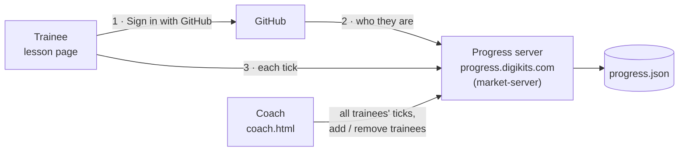

# Training progress server

Saves each trainee's lesson tick boxes under their GitHub sign-in, so ticks follow them to any computer and the coach sees everyone's progress on `coach.html`.



- Only GitHub usernames the coach adds on the coach page can save ticks. Anyone else who signs in is told to ask the coach.
- The server keeps only the GitHub username, never the GitHub password or access token.
- Plain Node 22, no packages. All data is one file, `data/progress.json`. Back it up by copying that file.

## One-time setup

You need about 20 minutes and SSH access to market-server.

### 1. Point a subdomain at the server

Wherever digikits.com's DNS is managed (Hover), add an **A record**: name `progress`, value = market-server's IP address.

### 2. Register a GitHub OAuth app

GitHub → Settings → Developer settings → OAuth Apps → **New OAuth App**

| Field | Value |
|---|---|
| Application name | DiGiKits Training |
| Homepage URL | `https://wdigi.github.io/tony/` |
| Authorization callback URL | `https://progress.digikits.com/callback` |

Click **Register**, then **Generate a new client secret**. Keep the Client ID and secret for step 3. Never put the secret in this repo.

### 3. Start the server on market-server

```bash
git clone https://github.com/wdigi/tony.git
cd tony/progress-server
cp .env.example .env
openssl rand -hex 32        # paste the result as SESSION_SECRET
nano .env                   # fill in GITHUB_CLIENT_ID, GITHUB_CLIENT_SECRET, SESSION_SECRET, COACHES
docker compose up -d --build
curl https://progress.digikits.com/health   # should print {"ok":true}
```

`COACHES` is your GitHub username (more than one: comma separated).

**Already have a web server on ports 80/443?** Run only the app: `docker compose up -d --build progress`, and add `progress.digikits.com` to your existing web server as a reverse proxy to `127.0.0.1:8080`.

### 4. Switch the site on

In `assets/progress-config.js` set:

```js
window.PROGRESS_SERVER = "https://progress.digikits.com";
```

Commit, wait a minute for GitHub Pages, then open **coach.html**, sign in, and add each trainee's GitHub username.

## Updating

```bash
cd tony && git pull && cd progress-server && docker compose up -d --build
```
